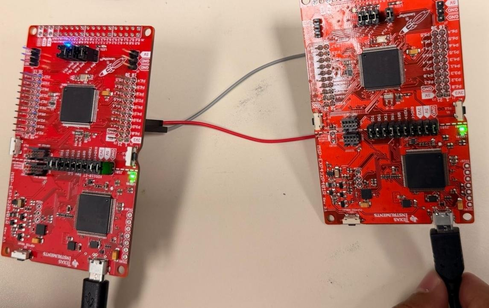
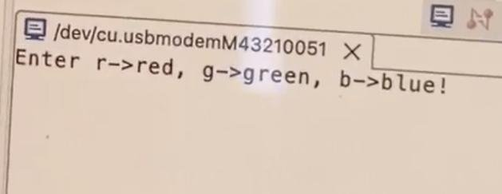
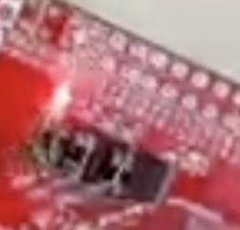
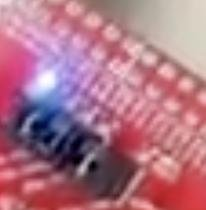
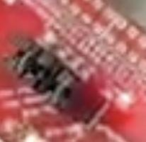

# 🌈 ChromaLink — Interrupt-Driven UART Link Between Two MCUs

> **Type a letter, light a color: bare-metal UART between two MSP432 boards.**


Two **MSP432P401R** LaunchPads talk over **UART (8N1, 9600 baud)** using the **eUSCI_A** peripherals, configured register by register in Code Composer Studio.

```
 PC terminal ──USB / eUSCI_A0──►  TRANSMITTER  ──eUSCI_A2 (P3.3 TX → P3.2 RX)──►  RECEIVER
   (keys)    ◄──── echo ────────     MSP432                                        MSP432
                                                                                 'r' → LED2 red
                                                                                 'g' → LED2 green
                                                                                 'b' → LED2 blue
                                                                                 other → LED1 blinks ×2
```

<p align="center"></p>

## Hardware & Software

- 2 × TI **MSP-EXP432P401R** LaunchPads, jumper wires (TX↔RX cross-over + common GND)
- **Code Composer Studio** + **SimpleLink MSP432 SDK**
- Serial terminal (CCS terminal, PuTTY, `screen`) at 9600 baud

| Link | Board | eUSCI | Pins | Clock | Baud |
|---|---|---|---|---|---|
| PC ↔ Transmitter | MSP432 | A0 (backchannel UART) | P1.2 RX, P1.3 TX | SMCLK 3 MHz | 9600 |
| Transmitter → Receiver | MSP432 | A2 | P3.2 RX, P3.3 TX | SMCLK 3 MHz | 9600 |

## Baud-Rate Calculation

`N = f_BRCLK / baud = 3 000 000 / 9600 = 312.5` → N > 16, so oversampling:

| Field | Value | Meaning |
|---|---|---|
| `OS16` | 1 | 16× oversampling |
| `UCBRx` (BRW) | INT(312.5/16) = **19** | coarse prescaler |
| `UCBRFx` | INT(0.53 × 16) = **8** | first-stage modulation |
| `UCBRSx` | **0x55** | second-stage modulation (from fractional part 0.5) |

## Repository Structure

```
├── uart_transmitter/main.c   # PC keystroke → echo + forward on eUSCI_A2
├── uart_receiver/main.c      # eUSCI_A2 RX ISR → RGB LED / error blink
└── images/
```

## Build & Run

1. In CCS create two **empty MSP432P401R** projects and replace each `main.c` with the files above.
2. Wire **TX board P3.3 → RX board P3.2**, **P3.2 ← P3.3**, and connect **GND ↔ GND**.
3. Flash both boards (USB).
4. Open a terminal on the transmitter's *XDS110 Application/User UART* port at 9600 8N1.
5. Type `r`, `g`, `b` or any other key and watch the receiver's LEDs.

## Results

| Terminal | 'r' | 'g' | 'b' | other |
|---|---|---|---|---|
|  |  |  |  |  |

The LED response to each keystroke was effectively instantaneous at 9600 baud, as expected.

## Implementation Notes

- Both eUSCI_A0 and eUSCI_A2 share one `uart_init_9600()` routine (reset → SMCLK → BRW/MCTLW → release).
- The transmitter echoes every keystroke to the terminal and forwards it to the receiver.
- All I/O is interrupt-driven; the main loops are empty.

## Concepts Covered

- eUSCI_A architecture and UART framing (start, data, parity, stop bits; 8N1/8E1/8O1/7N1)
- Baud-rate generation with oversampling and two-stage modulation
- Interrupt-driven, non-blocking serial I/O (NVIC, RXIFG/TXIFG)
- Comparison of SPI, I²C, UART, CAN, LIN, RS-485, USB, Ethernet and wireless protocols

## Author

- **Aryan Verma**
